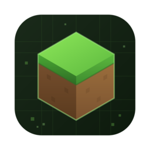

# MCBE Toolbox




[](../LICENSE)

[[简体中文](README_ZH.md) | **English**]

> Most of the content of this document was generated by AI and is awaiting review

A toolbox for **Minecraft Bedrock Edition (MCBE)** content creators: convert images, videos and GIFs into block images, block videos, pixel-art structure files or function files, with a built-in NBT editor.

## Table of Contents

- [MCBE Toolbox](#mcbe-toolbox)
    - [Table of Contents](#table-of-contents)
    - [Introduction](#introduction)
    - [Features](#features)
    - [Screenshots](#screenshots)
    - [Build](#build)
        - [Requirements](#requirements)
        - [Getting the Source](#getting-the-source)
        - [Configure and Build](#configure-and-build)
        - [CMake Options](#cmake-options)
    - [Tech Stack and Third-Party Libraries](#tech-stack-and-third-party-libraries)
    - [Known Limitations and Roadmap](#known-limitations-and-roadmap)
    - [License](#license)
    - [Author](#author)

## Introduction

MCBE Toolbox consists of a backend generator library (`backend/`) and a Qt6 frontend (`frontend/`): the backend implements the core algorithms (image/video sampling, block color matching, NBT structure/function generation), while the frontend provides a visual UI for configuring parameters, selecting blocks, tracking progress, and editing NBT data.

## Features

- **Block Image/Video Generator**: converts an image into a block-art image (PNG), or a video into a block-art video (MP4).
- **Pixel-Art Generator**: converts an image/video/GIF into a Minecraft behavior pack (`.mcpack`) containing either a structure file (`.mcstructure`) or a function file (`.mcfunction`), with both single-file and per-frame split modes. (Currently, the frontend only provides per-frame split mode)
- **Block filtering and management**: filter available blocks by attributes (transparent, luminous, affected by gravity, etc.), with fallback block (Used for fill transparent pixels) support and block usage statistics.
- **NBT Editor**: view and edit NBT files, convert between NBT and SNBT, switch endianness, and GZip compress/decompress.
- **Multi-language UI**: built-in English / Simplified Chinese, powered by a runtime translation system ([easy_translate](https://github.com/JaderoChan/easy_translate)) that is easy to extend with more languages.
- **Multi-threaded generation**: generation tasks run on a background thread, with progress reporting and the ability to cancel at any time.

## Screenshots

> Reserved placeholders temporarily.


## Build

### Requirements

| Item | Requirement |
| --- | --- |
| OS | Windows 10+ / macOS / Linux (The frontend has not yet made targeted adaptations for Linux) |
| Compiler | Any C++17-capable compiler |
| CMake | 3.26 or newer |
| Qt | 6.7 or newer (`Widgets` component) |
| OpenCV | `core`, `imgcodecs`, `videoio` components |
| Python 3 | Optional, used by a few build helper scripts (e.g. macOS RPATH fix-up, block color data generation) |

The remaining third-party dependencies (zlib, nlohmann/json, minizip-ng, mcnbt, easy_translate) are vendored directly in the repository under `3rdparty/`, so no extra installation is required.

### Getting the Source

```bash
git clone https://github.com/JaderoChan/MCBEToolbox.git
cd MCBEToolbox
```

### Configure and Build

```bash
cmake -S . -B build -DCMAKE_BUILD_TYPE=Release
cmake --build build --config Release
```

Build outputs are placed under `build/frontend/bin/` (the `MCBEToolbox` executable) and `build/backend/` (the `MCBEToolboxBackend` static library).

### CMake Options

| Option | Purpose | Default | Notes |
| --- | --- | --- | --- |
| `MCBT_ENABLE_LTO` | Enable link-time optimization (LTO/IPO) for Release builds | `ON` | Falls back with a warning when unsupported by the toolchain |
| `MCBT_OPTIMIZE_FOR_SIZE` | Prefer code size over speed for Release builds | `OFF` | Significantly reduces binary size when statically linking large dependencies such as OpenCV |
| `KEEP_TERMINAL` | Keep the program's console window | `OFF` | **Windows** only |
| `UPDATE_TRANSLATION_MAPPING_FILE` | Auto-extract the translation ID list on exit | `OFF` | Development use, for extracting text pending translation |
| `EMBED_APP_MANIFEST` | Embed `app.manifest` into the resource file | `OFF` | **Windows** only |
| `DEPLOYQT_AFTER_BUILD` | Automatically run Qt deployment after the build | `ON` | Requires such as `windeployqt` / `macdeployqt` to be available |
| `CREATE_DMG` | Create a DMG package after the build | `OFF` | **macOS** only, requires `create-dmg` to be available |

## Tech Stack and Third-Party Libraries

- Languages: C++17, CMake, Python 3 (build helper scripts)
- GUI framework: [Qt 6](https://www.qt.io/) (Widgets)
- Image/video processing: [OpenCV](https://github.com/opencv/opencv)
- JSON: [nlohmann/json](https://github.com/nlohmann/json)
- NBT reading/writing: [mcnbt](https://github.com/JaderoChan/mcnbt)
- Compression and packaging: [zlib](https://github.com/madler/zlib), [minizip-ng](https://github.com/zlib-ng/minizip-ng)
- Runtime text translation: [easy_translate](https://github.com/JaderoChan/easy_translate)

## Known Limitations and Roadmap

The current design has a few known limitations (minimum supported game version (1.21.50), block placement direction assumptions, etc.), documented in [限制.md](docs/限制.md) (Chinese only); planned future work is tracked in [TODO.md](docs/TODO.md).

## License

This project is open-sourced under the [MIT License](LICENSE). Each third-party dependency under `3rdparty/` retains its own original license (see the `LICENSE` file in its respective directory).

## Author

**頔珞 JaderoChan** · [GitHub](https://github.com/JaderoChan) · c_dl_cn@outlook.com
