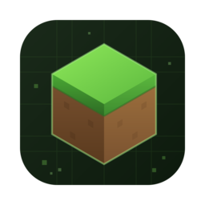

# MCBE Toolbox




[](../LICENSE)

[**简体中文** | [English](README.md)]

> 此文档大部分内容由 AI 总结，待审查

一个面向 **Minecraft 基岩版（MCBE）** 内容创作者的工具箱：将图片 / 视频 / GIF 转换为方块图片、方块视频、像素画结构文件或函数文件，并内置一个 NBT 编辑器。

## 目录

- [MCBE Toolbox](#mcbe-toolbox)
    - [目录](#目录)
    - [简介](#简介)
    - [功能](#功能)
    - [界面截图](#界面截图)
    - [构建](#构建)
        - [环境需求](#环境需求)
        - [获取源码](#获取源码)
        - [配置与构建](#配置与构建)
        - [CMake 选项](#cmake-选项)
    - [技术栈与第三方库](#技术栈与第三方库)
    - [已知限制与规划](#已知限制与规划)
    - [许可证](#许可证)
    - [作者信息](#作者信息)

## 简介

MCBE Toolbox 由后端生成库（`backend/`）与 Qt6 前端界面（`frontend/`）组成：后端负责图像 / 视频采样、方块颜色匹配、NBT 结构与函数生成等核心算法，前端提供可视化的参数配置、方块选择、进度展示与 NBT 编辑能力。

## 功能

- **方块图片 / 视频生成器**：将图片转换为方块拼图（PNG），将视频转换为方块拼图视频（MP4）。
- **像素画生成器**：将图片 / 视频 / GIF 转换为 Minecraft 结构文件（`.mcstructure`）或函数文件（`.mcfunction`）打包的行为包（`.mcpack`），支持单文件与逐帧拆分两种模式。（当前前端仅提供逐帧拆分模式）
- **方块筛选与管理**：按方块属性（透明、发光、重力等）筛选可用方块，支持 Fallback 方块（透明像素填充方块）与方块用量统计。
- **NBT 编辑器**：查看与编辑 NBT 文件，NBT 与 SNBT 互转，大小端序转换，GZip 压缩 / 解压缩。
- **多语言界面**：内置简体中文 / English，基于 [easy_translate](https://github.com/JaderoChan/easy_translate) 的运行时翻译系统，易于扩展更多语言。
- **多线程生成**：生成任务在后台线程执行，支持进度展示与用户随时取消。

## 界面截图

> 暂时预留位置。


## 构建

### 环境需求

| 项目 | 要求 |
| --- | --- |
| 操作系统 | Windows 10+ / macOS / Linux（前端暂时没有对 Linux 做针对性适配） |
| 编译器 | 支持 C++17 的编译器 |
| CMake | 3.26 及以上 |
| Qt | 6.7 及以上（`Widgets` 组件） |
| OpenCV | `core`、`imgcodecs`、`videoio` 组件 |
| Python 3 | 可选，用于部分构建辅助脚本（如 macOS 平台的 RPATH 修复、方块颜色数据生成） |

其余第三方依赖（zlib、nlohmann/json、minizip-ng、mcnbt、easy_translate）已随仓库一同提供（位于 `3rdparty/` 目录下），无需额外安装。

### 获取源码

```bash
git clone https://github.com/JaderoChan/MCBEToolbox.git
cd MCBEToolbox
```

### 配置与构建

```bash
cmake -S . -B build -DCMAKE_BUILD_TYPE=Release
cmake --build build --config Release
```

构建产物位于 `build/frontend/bin/`（可执行文件 `MCBEToolbox`）与 `build/backend/`（静态库 `MCBEToolboxBackend`）下。

### CMake 选项

| 选项 | 作用 | 默认值 | 备注 |
| --- | --- | --- | --- |
| `MCBT_ENABLE_LTO` | 为 Release 构建启用链接时优化（LTO/IPO） | `ON` | 工具链不支持时自动回退并给出警告 |
| `MCBT_OPTIMIZE_FOR_SIZE` | Release 构建优先优化体积而非速度 | `OFF` | 配合静态链接 OpenCV 等大型依赖可显著减小产物体积 |
| `KEEP_TERMINAL` | 保留程序控制台入口（用于开发调试） | `OFF` | 仅 **Windows** 平台下可用 |
| `UPDATE_TRANSLATION_MAPPING_FILE` | 程序退出后自动提取文本翻译 ID 列表 | `OFF` | 仅用于开发阶段提取待翻译文本 |
| `EMBED_APP_MANIFEST` | 将 `app.manifest` 嵌入资源文件 | `OFF` | 仅 **Windows** 平台下可用 |
| `DEPLOYQT_AFTER_BUILD` | 构建结束后自动执行 Qt 部署 | `ON` | 需要保证 `windeployqt` / `macdeployqt` 等工具可见 |
| `CREATE_DMG` | 构建结束后进行 DMG 打包 | `OFF` | 仅 **macOS** 平台下可用，需要保证 `create-dmg` 工具可见 |

## 技术栈与第三方库

- 语言：C++17、CMake、Python 3（构建辅助脚本）
- GUI 框架：[Qt 6](https://www.qt.io/)（Widgets）
- 图像 / 视频处理：[OpenCV](https://github.com/opencv/opencv)
- JSON：[nlohmann/json](https://github.com/nlohmann/json)
- NBT 读写：[mcnbt](https://github.com/JaderoChan/mcnbt)
- 压缩与打包：[zlib](https://github.com/madler/zlib)、[minizip-ng](https://github.com/zlib-ng/minizip-ng)
- 运行时文本翻译：[easy_translate](https://github.com/JaderoChan/easy_translate)

## 已知限制与规划

当前设计与实现存在一些限制（如最低兼容游戏版本（1.21.50）、方块摆放方向假设等），详见 [限制说明](docs/限制.md)；后续开发计划见 [TODO](docs/TODO.md)。

## 许可证

本项目基于 [MIT 许可证](LICENSE) 开源。`3rdparty/` 下的第三方依赖各自保留其原始许可证（见各自目录下的 `LICENSE` 文件）。

## 作者信息

**頔珞 JaderoChan** · [GitHub](https://github.com/JaderoChan) · c_dl_cn@outlook.com
